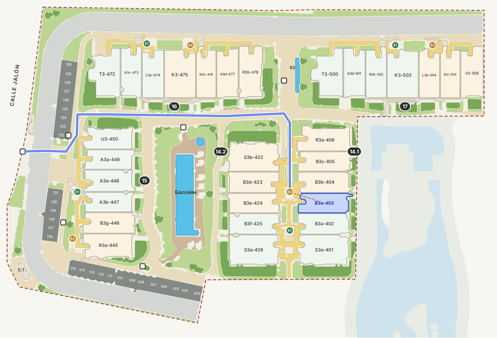

# FlamencaDemoPlan

Навигатор по жилому комплексу Flamenca Village. Четыре листа мастер-плана (Фазы 1–3 и корпуса 14–17) сведены в один векторный план. По номеру апартамента сервис показывает лестницу, лифт, этаж и пеший маршрут по территории до нужной лестницы.

Сайт: https://alkosu.github.io/FlamencaDemoPlan/



## Что умеет

Страница на чистом JS, без сервера и сборщиков, рассчитана прежде всего на смартфоны. В шапке — переключатель **Simple / Pro** и выбор языка; выбор запоминается в браузере.

**Simple** — режим по умолчанию:
- **Ввод номера.** Крупное поле для номера апартамента (`1`–`506`, коммерческие помещения — `Loc.5`), выбор точки «Откуда» и кнопка «Искать».
- **Ответ.** Карточки с номером лестницы (Escalera), лифта, этажа и расстоянием пешком.
- **План.** Маршрут по дорожкам до лестницы. Из блоков квартир остаются только нужный и два соседних в том же корпусе, видна только нужная лестница.

**Pro** — полный режим:
- Поиск по номеру или коду с подсказками, старт из любой точки плана.
- Этаж на плане и режимы «все / корпус / квартира».
- Панель слоёв: блоки квартир, номера, лестницы, лифты, корпуса, галереи, инфраструктура по легенде, бассейны, зелень, дорожки, проезды, парковка, сеть маршрутов, исходные планы.
- Пошаговое описание маршрута.

**Языки:** español, English, français, русский. По умолчанию язык берётся из настроек браузера, а если он не из этого списка — испанский.

**Точки «Откуда»:** вход с Calle Jalón, вход с Calle Pablo Picasso, южный и северный входы, бассейны, офис TM.

### Ссылки и QR-коды

| Ссылка | Что откроется |
|---|---|
| `…/FlamencaDemoPlan/#449` | сразу маршрут до апартамента 449 (можно и код: `#A3a-449`) |
| `…/FlamencaDemoPlan/?lang=en#449` | то же на английском (`es`, `en`, `fr`, `ru`) |
| `…/FlamencaDemoPlan/?mode=pro` | открыть режим Pro |

## Быстрый старт

Откройте `index.html` в браузере — страница работает и с диска (`file://`), данные подключаются обычным скриптом. Или через локальный сервер:

```bash
python -m http.server 8000
```

Публикация: **Settings → Pages**, ветка `main`, папка `/ (root)`. Файл `.nojekyll` уже в корне.

## Структура

```
index.html                  страница
assets/app.js               логика: отрисовка, слои, маршрут (Дейкстра по сети дорожек), поиск, языки
assets/style.css            стили (светлая и тёмная тема)
data/complex.json           настройки: заголовок, языки, точки старта по умолчанию
data/qgis/flamenca.gpkg     ← ПРАВИТСЯ В QGIS: дорожки, лестницы, точки старта, лифты, щиты воды (docs/QGIS.md)
data/master/                сводная модель комплекса
  model.json                стояки (контуры, коды квартир), лестницы, объекты легенды, 522 помещения
  vector.json               векторные слои территории
  paths.json                автосеть дорожек (исходник для flamenca.gpkg)
  blocks.json               ручная разметка блоков по листам (коды, границы стояков)
  global.json               матрицы привязки каждого листа к общей системе координат
data/plan-data.js           сгенерировано: всё для страницы
source/sheets/              исходные листы мастер-плана (Фаза 1, 2, 3, корпуса 14–17)
source/master.jpg           сводная подложка из четырёх листов
export/plan_layers.svg      сводный план со слоями, в том числе по этажам (Inkscape, Figma, Illustrator)
export/apartments.csv       перечень апартаментов и помещений (UTF-8, разделитель «;»)
tools/build.py              сборка data/plan-data.js и export/* из data/* (только стандартная библиотека)
tools/check_routes.py       проверка: от каждой точки старта достижимы все лестницы
tools/qgis_export.py        пересоздать flamenca.gpkg из автосети (затирает правки!)
tools/master/               конвейер, которым листы были совмещены и разобраны (см. его README)
```

## Как обновить данные

Дорожки, точки «Откуда», лифты и щиты воды правятся в QGIS в файле `data/qgis/flamenca.gpkg`. Пошаговая инструкция — в **[docs/QGIS.md](docs/QGIS.md)**. После правки:

```bash
python tools/build.py
python tools/check_routes.py
```

`build.py` пересобирает `data/plan-data.js`, `export/plan_layers.svg` и `export/apartments.csv`. Сторонние библиотеки ему не нужны.

Новый лист или исправленный мастер-план обрабатываются конвейером в `tools/master/`.

## Как собран сводный план

- **Совмещение листов.** Каждый лист привязан к общей системе координат по общим объектам — бассейнам, лагуне, отметкам высот. Расхождение по контрольным точкам — 1–3 пикселя (≈0,1–0,3 м). Где листы перекрываются, участок берётся со своего листа.
- **Номера.** Распознано 506 апартаментов (1–506) без пропусков и повторов и 16 коммерческих помещений (Loc. 1–16). Числа совпадают с количествами по подфазам на листах: Фаза 1 — 128, Фаза 2 — 132, Фаза 3 — 122, корпуса 14–17 — 124.
- **Векторизация.** Территория разобрана по цветам (корпуса, террасы, галереи, дорожки, проезды, парковка, зелень, бассейны). Стояки квартир вырезаны по ручной разметке блоков.
- **Сеть дорожек** получена из скелета проходимых зон: дорожки, проезды, галереи, настилы у бассейнов. Лестницы и входы привязаны к ближайшим узлам.

## Допущения и ограничения

- **Этаж** берётся из цифры в коде: `A3a-449` — 3-й этаж, 0 — planta baja.
- **Лестницы** (25 шт.) отмечены по значкам на листах. У корпуса 10 и южной лестницы корпуса 9 значки мелкие — их стоит сверить с поэтажными планами.
- **Лифты** на листах не обозначены. Пока слой `lifts` в QGIS пуст, лифт условно показывается у каждой лестницы.
- **Маршрут** строится до лестницы; путь по галерее до двери описан текстом. Расстояния приблизительные (~0,1 м/px).
- **Корпуса 14–17** — на их листе не видно номера фазы, в данных они идут отдельной группой.

## Лицензия

Код — [MIT](LICENSE). Исходные листы мастер-плана (`source/`) и полученные из них данные (`data/master/`, `data/plan-data.js`, `export/`) принадлежат правообладателю проекта комплекса и под лицензию MIT не подпадают.
